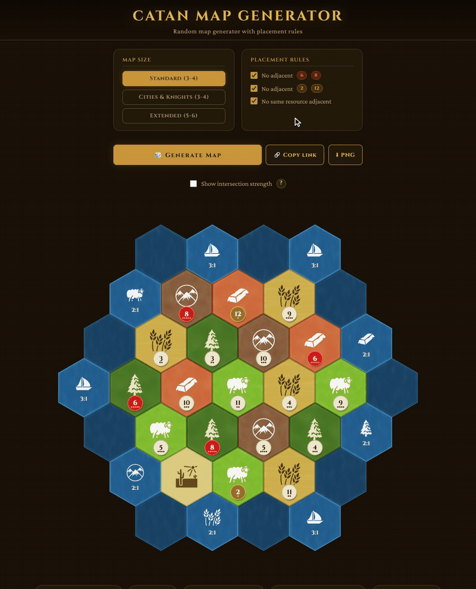
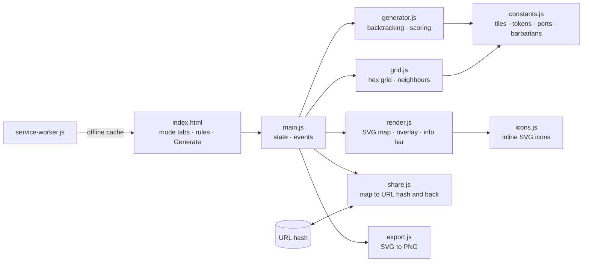
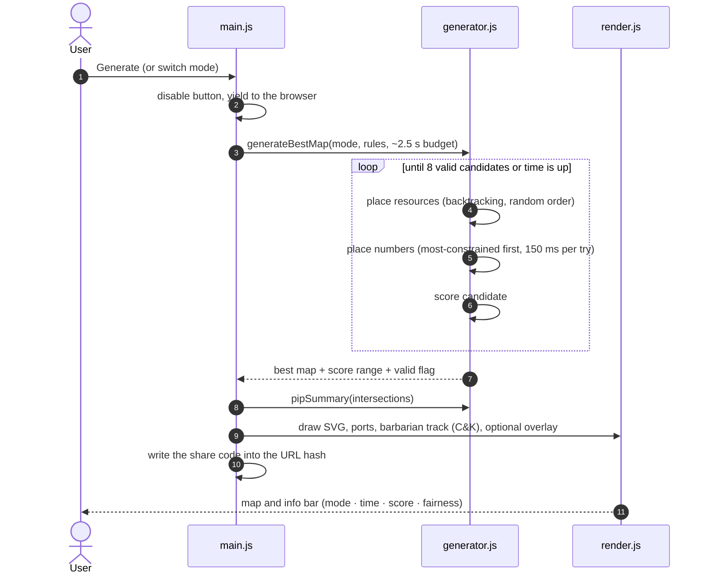
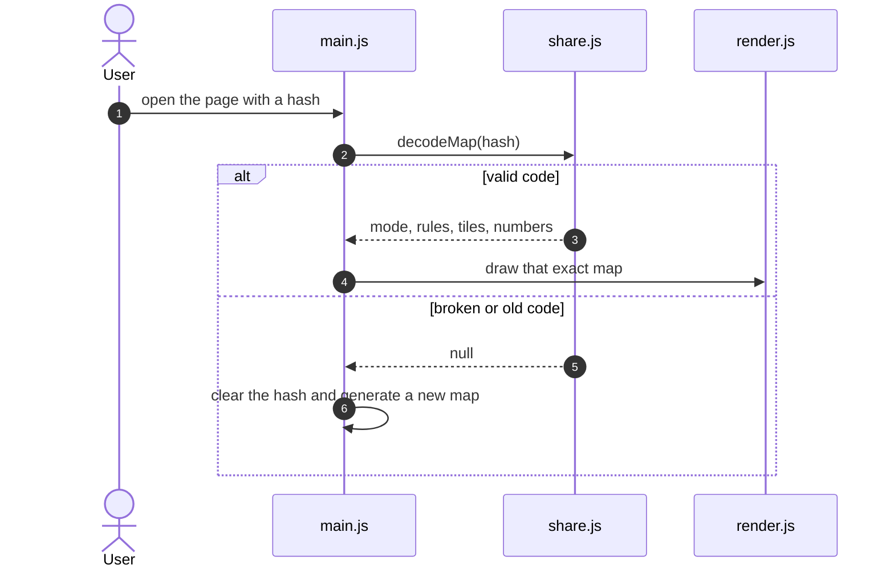

<div align="center">

# 🗺️ Catan Map Generator

[](https://github.com/pero-grubac/catan-map-generator/actions/workflows/ci.yml)
[](https://github.com/pero-grubac/catan-map-generator/actions/workflows/deploy.yml)


**Balanced random boards for Catan: standard, Cities & Knights and the 5–6 player extension, with placement rules and a scoring pass that keeps the fairest map.**

[](https://pero-grubac.github.io/catan-map-generator/)



</div>

---

## 📌 Project Overview

**Catan Map Generator** is a random map generator for the Catan board game. It supports the standard 3-4 player map, the Cities & Knights 3-4 player board, and the 5-6 player extension, with configurable placement rules and a scoring system that picks the most balanced result from multiple valid candidates. Runs entirely in the browser — no backend, no dependencies, no build step. Works offline as a PWA.

---

## ✨ Features

- 🗺️ **Three map modes** — Standard (19 land tiles, 3-4 players), Cities & Knights (same 19 tiles, its own harbours and barbarian track) and Extended (30 land tiles, 5-6 players)
- 🏴‍☠️ **Cities & Knights board** — the harbour layout of the C&K frame, plus the barbarian ship track drawn along the east coast (pirate ship at both ends, wave crests between)
- ⚙️ **Placement rules** (each toggleable):
  - No adjacent `6` and `8` tokens
  - No adjacent `2` and `12` tokens
  - No same resource type touching
- **Smart generation** — backtracking algorithm guarantees constraint satisfaction; no arbitrary retry limits
- **Scoring system** — generates multiple valid candidates and picks the most balanced one
- **Fixed ports** — official Catan port layout per mode, same positions every game
- **Non-blocking UI** — generation runs asynchronously; page never freezes
- 🔗 **Share links** — the URL always holds the map on screen; send it and the other person sees the exact same board
- 🎯 **Fairness view** — optional overlay with the pip total of every intersection, plus best spot, number of 10+ spots and pips per resource in the info bar; the **?** next to the toggle explains how it is counted
- ⬇ **PNG export and print** — download the map as a 2× PNG (textures, icons, barbarian track and overlay included), or press Ctrl+P to print just the map and info bar on one page

---

## 🛠️ Tech Stack

| Technology | Usage |
|------------|-------|
| Vanilla JavaScript (ES modules) | Grid, backtracking generator, scoring, UI |
| SVG | Hex tiles with procedural fractal-noise textures, icons, ports, barbarian track |
| HTML5 + CSS3 | Layout and the dark parchment theme |
| Cinzel, Crimson Pro, Oswald | Self-hosted WOFF2 fonts |
| Web App Manifest + Service Worker | Install support, offline cache |
| Canvas API | PNG export of the SVG map, no libraries |
| `node:test` | Grid, generator, share-link and constants tests, no test framework to install |
| Playwright | End-to-end smoke tests on desktop and phone viewports |
| Lighthouse CI | Performance, accessibility and best-practice audit of the deployed files |
| GitHub Actions + GitHub Pages | CI and deployment |

---

## 📦 Installation

The app itself has no dependencies and no build step. You only need:

- [Git](https://git-scm.com/)
- [Node.js](https://nodejs.org/) 20 or newer (for the tests and the local server; the app does not need it)

```bash
git clone https://github.com/pero-grubac/catan-map-generator.git
cd catan-map-generator
```

The app has no runtime dependencies and the unit tests use Node's built-in test runner, so neither needs an install. Only the end-to-end tests need one dev dependency (Playwright):

```bash
npm install
```

---

## ▶️ Usage

### Run locally

The app uses ES modules and a Service Worker, so it must be served over HTTP. Opening `index.html` from `file://` will not work. Any static server works:

```bash
npm start                      # npx serve on http://localhost:8080
# or
python -m http.server 8080     # then open http://localhost:8080
# or, in VS Code: right-click index.html → Open with Live Server
```

On `localhost` the Service Worker skips caching, so changes show up on a normal reload.

### Generate a map

1. Pick a board: **Standard (3-4)**, **Cities & Knights (3-4)** or **Extended (5-6)**. A new map is generated straight away.
2. Turn the placement rules on or off.
3. Click **🎲 Generate Map** to roll a new layout with the current rules.

The info bar shows the mode, the generation time, the score range of the candidates and whether the result meets every rule. If no fully valid map is found within the time budget, a best-effort map is shown with a warning. A second row shows the fairness summary: the strongest intersection, how many intersections reach 10 pips or more, and the pips each resource gets.

### Share a map

Every generated map is written into the address bar (`…/catan-map-generator/#ARw…`). Click **🔗 Copy link** to copy it (on a phone it opens the share sheet instead). Opening the link draws that exact map, with its mode and rule switches, without generating anything. A broken or outdated link is ignored and a fresh map is generated.

### See how fair the map is

Tick **Show intersection strength** to put a small disc on every intersection with its pip total. Bigger and warmer means stronger: grey 1–4, gold 5–9, orange 10–12, red 13+. The discs sit on the hex corners and stay clear of the number tokens.

### Export or print

- **⬇ PNG** downloads `catan-<mode>-map.png` at twice the map's size, exactly as shown (overlay included if it is on).
- **Ctrl+P** prints only the map and the info bar, sized to fit one page.

### Run the tests

```bash
npm test            # unit tests, no install needed
npm run test:e2e    # end-to-end smoke tests (after npm install)
```

The unit tests cover the hex grid (neighbours and intersections checked against the real hex geometry), the generator (tile and token counts, all three placement rules over many random runs, scoring and the fallback path), the pip counting, the share-link format (round trips in all three modes and a set of corrupt links), the port and barbarian-track definitions, and the Service Worker's list of cached files.

The end-to-end tests run in Chromium at a desktop and a phone size: generating in all three modes, copying a link and opening it to get the identical map, a broken link, the overlay toggle (including that no disc covers a token), the PNG download and the phone layout. Any console error fails a test. Playwright downloads its own browser with `npx playwright install chromium`; to use one you already have, set `PW_CHROMIUM_PATH=/path/to/chrome`.

---

## 🗃️ Tile counts

### Standard (3-4 players)

| Resource | Tiles | Numbers |
|----------|-------|---------|
| Forest   | 4     | 2×(3,4,5,9,10,11), 1×(6,8,12) |
| Grain    | 4     | — |
| Sheep    | 4     | — |
| Rock     | 3     | — |
| Clay     | 3     | — |
| Desert   | 1     | — (no token) |
| **Total** | **19** | **18 number tokens** |

Number tokens: `2, 3, 3, 4, 4, 5, 5, 6, 6, 8, 8, 9, 9, 10, 10, 11, 11, 12`

### Extended (5-6 players)

| Resource | Tiles |
|----------|-------|
| Forest   | 6     |
| Grain    | 6     |
| Sheep    | 6     |
| Rock     | 5     |
| Clay     | 5     |
| Desert   | 2     |
| **Total** | **30** |

Number tokens: `2×(2,12), 3×(3,4,5,9,10,11), 3×(6,8)` — 28 tokens total

---

## 🔗 Share link format

Generation is time-budgeted, so the same random seed would not give the same map twice. The link therefore stores the finished map, not a seed: a few bytes, written as URL-safe base64 (no padding) after the `#`.

| Byte | Content |
|------|---------|
| 0 | Format version (`1`) |
| 1 | Bits 0–1: mode (`0` standard, `1` Cities & Knights, `2` extended). Bit 2: no 6/8, bit 3: no 2/12, bit 4: no same resource |
| 2 … | One byte per land hex, in grid order (rows top to bottom, left to right). High 4 bits: resource (`0` forest, `1` grain, `2` sheep, `3` rock, `4` clay, `5` desert). Low 4 bits: the number token (`0` for the desert) |

A standard board is 21 bytes (28 characters), the extended one 32 bytes (43 characters). Ports are fixed per mode, so they are not stored. When a link is opened it is only accepted if the version, mode and length match and the tiles and tokens are exactly the set in the box. Anything else is ignored. The code lives in `src/share.js` and has no DOM dependencies.

---

## 🎯 Fairness view: how pips are counted

The dots on a number token, its *pips*, count how many of the 36 two-dice rolls produce that number:

| Number | 2 / 12 | 3 / 11 | 4 / 10 | 5 / 9 | 6 / 8 | Desert |
|--------|--------|--------|--------|-------|-------|--------|
| Pips   | 1      | 2      | 3      | 4     | 5     | 0      |

An intersection is a corner shared by up to three land hexes (three inland, one or two on the coast). Its strength is the sum of the pips of the land hexes it touches, so a corner on a 6, an 8 and a 9 has 5 + 5 + 4 = 14 pips. The standard board has 54 intersections and the extended board 80. `buildVertices` in `grid.js` finds them by collecting every hex corner and merging the ones that coincide. `pipSummary` in `generator.js` turns them into the totals, the best spot, the count of 10+ spots and the pips per resource.

---

## 🏗️ Architecture



### One click on Generate



### Opening a shared link



---

## ⚙️ How it works

### Grid construction

The map is built as a complete hex grid — a fixed sea ring surrounding the land hexes. Sea hex positions are computed automatically: for each land hex, all six pixel-space neighbours that aren't land become sea hexes (duplicates deduplicated by rounded pixel key). Ports are placed at fixed sea hex positions following the official Catan layout — same port, same spot, every time. In Cities & Knights mode the barbarian track is not made of extra hexes: its marks are placed at fixed offsets inside the existing east-coast sea hexes, each one checked to lie fully inside its hex and clear of the harbour icon.

### Generation pipeline

Generation runs in three stages and repeats until a time budget (~2.5s) is exhausted. The highest-scoring valid result is returned.

#### 1. Resource placement — backtracking with random visit order

| Step | Description |
|------|-------------|
| Shuffle visit order | Every hex has equal chance of getting any resource — Desert won't always land at the end |
| Random type order | At each hex, resource types are tried in random order |
| Immediate rejection | Violating types are skipped on the spot, no full-board undo needed |
| Backtrack | If no type works, the algorithm steps back and tries the next option |

#### 2. Number placement — backtracking with degree ordering

| Step | Description |
|------|-------------|
| Degree sort | Dense centre tiles are filled first — most constrained slots placed earliest |
| Random token order | Tokens tried randomly at each slot |
| Immediate rejection | Adjacent 6-8 or 2-12 pairs rejected on placement |
| Per-attempt deadline | If backtracking stalls (~150ms), restart with a fresh resource layout |

#### 3. Scoring & selection

Up to 8 valid candidates are collected within the time budget. Each is scored and the best is displayed:

| Situation | Score |
|-----------|-------|
| Adjacent 6 and 8 | −100 |
| Adjacent 2 and 12 | −40 |
| Adjacent same resource | −20 |
| Unbalanced probability spread | −variance |

A perfect map scores 0. The score range shown in the UI (e.g. `−2 → −18`) tells you how much variation there was between the best and worst candidates found in that run.

---

## 📁 Project Structure

```
catan-map-generator/
├── index.html            # Markup and layout
├── style.css             # Dark theme styling
├── manifest.json         # PWA manifest (name, icons, display mode)
├── service-worker.js     # Offline caching (network-first pages, cached files refreshed in the background)
├── package.json          # npm scripts (test, test:e2e, start); Playwright as the only dev dependency
├── README.md
├── src/
│   ├── main.js           # Entry point: UI state, event wiring, generation trigger
│   ├── constants.js      # Tile/token sets, port layouts, barbarian track, colours
│   ├── grid.js           # Hex grid and neighbour lookup
│   ├── generator.js      # Backtracking placement, scoring, best-map selection
│   ├── render.js         # SVG rendering, strength overlay, info bar and warnings
│   ├── share.js          # Share-link encode/decode (pure, no DOM)
│   ├── export.js         # SVG → PNG export with embedded fonts
│   └── icons.js          # Inline SVG icon paths (game-icons.net)
├── tests/                # node:test suites for grid, generator, share links and constants
│   └── e2e/              # Playwright smoke tests and a tiny static server
├── playwright.config.js  # e2e config (desktop and phone projects)
├── lighthouserc.json     # Lighthouse CI settings
├── readme_assets/
│   └── demo.gif          # The demo at the top of this README
├── .github/workflows/
│   ├── ci.yml            # Unit, e2e and Lighthouse on pull requests and non-main branches
│   └── deploy.yml        # Unit and e2e tests, then deploy to GitHub Pages on push to main
├── fonts/
│   ├── cinzel-400.woff2
│   ├── cinzel-600.woff2
│   ├── cinzel-700.woff2
│   ├── crimson-pro-400.woff2
│   ├── crimson-pro-500.woff2
│   ├── crimson-pro-600.woff2
│   ├── oswald-400.woff2
│   ├── oswald-600.woff2
│   └── oswald-700.woff2
└── icons/
    ├── icon-192.png      # PWA icon (home screen)
    └── icon-512.png      # PWA icon (splash screen)
```

<details>
<summary>🔷 icons/</summary>

PWA icons used by the browser for home screen shortcuts and splash screens.

**Resource & port icons** — rendered as inline SVG paths directly in `src/icons.js` (procedural fractal-noise tile textures plus real illustrated icons), no image files needed.

</details>

---

## 🚀 CI/CD

Two GitHub Actions workflows live in `.github/workflows/`:

| Workflow | Runs on | What it does |
|----------|---------|--------------|
| `ci.yml` | Every push (including `main`) and pull request | Three parallel jobs: **unit** (`npm test`), **e2e** (Playwright smoke tests in Chromium, desktop and phone; the test output is uploaded when a test fails) and **lighthouse** (Lighthouse CI on exactly the files that get deployed; the report is uploaded as an artifact) |
| `deploy.yml` | After **CI passes on `main`**, or a manual run | Publishes the site's files to GitHub Pages; the tests already ran in CI |

Deploy is chained to CI (`workflow_run`): a push to `main` is tested once, and only a green run is published, from exactly the commit that was tested. Documentation-only commits start neither.

CI **skips documentation-only changes**: a commit that only touches `*.md`, `readme_assets/`, `LICENSE`, `.gitignore` or `.vscode/` does not start a run. A newer run on the same branch cancels the one still in progress.

The deploy publishes only the files the site needs (`index.html`, `style.css`, `manifest.json`, `service-worker.js`, `src/`, `fonts/`, `icons/`). Tests and tooling are not deployed.

**One-time setup:** in the repo go to **Settings → Pages → Build and deployment → Source** and choose **GitHub Actions**. Leaving it on "Deploy from a branch" would publish `main` directly and skip the tests. The site is served at `https://pero-grubac.github.io/catan-map-generator`.

> **After each release:** bump `CACHE` in `service-worker.js` (e.g. `v7` → `v8`) so returning users get the new files. If you add a file under `src/`, also add it to `SHELL` there. A test fails if any module in `src/` is missing from that list.

---

## ⚠️ Known limitations

- **Extended + "no same resource"** — with 6 copies of 3 resource types on a dense 30-hex grid, backtracking is feasible but generation time varies. If it exceeds the time budget, a best-effort result is shown with a warning.
- The generator uses client-side JS only — no server, no runtime dependencies, no build tooling.

---

## 🙏 Credits

Resource, port and barbarian-track icons (pine tree, wheat, sheep, mountains, clay brick, desert, sailboat, galleon, wave crest) are by [Lorc](https://lorcblog.blogspot.com/) and [Delapouite](https://delapouite.com/), from [game-icons.net](https://game-icons.net/), licensed under [CC BY 3.0](https://creativecommons.org/licenses/by/3.0/).

---

*Catan is a registered trademark of Catan GmbH. This is an unofficial fan tool.*
